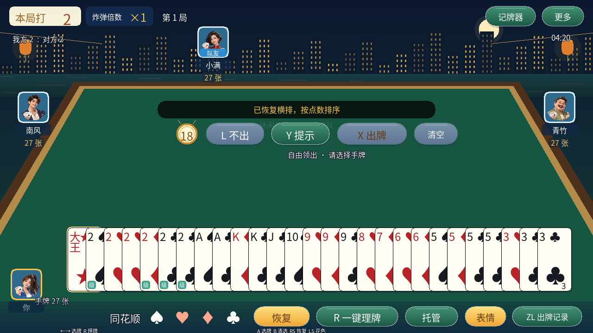
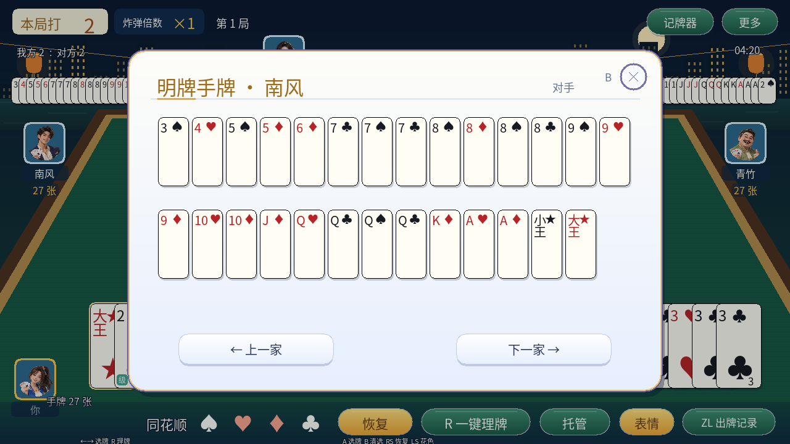
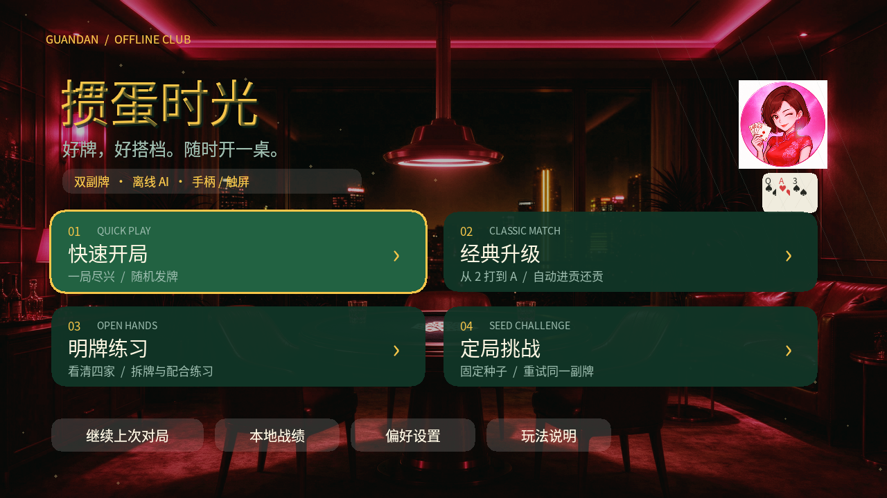
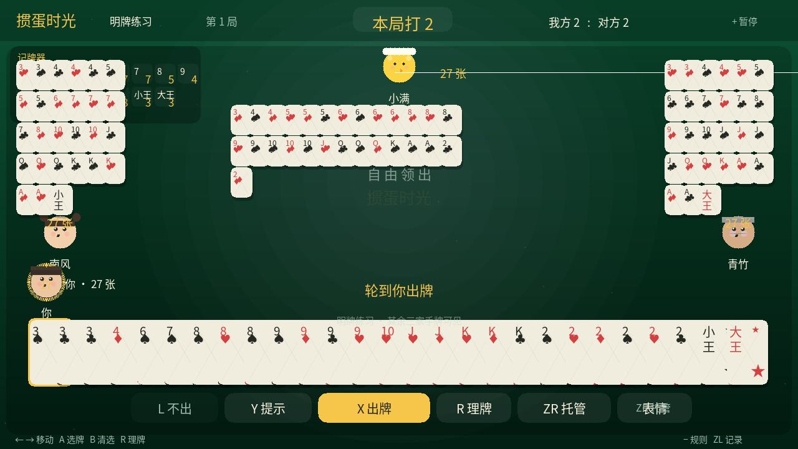
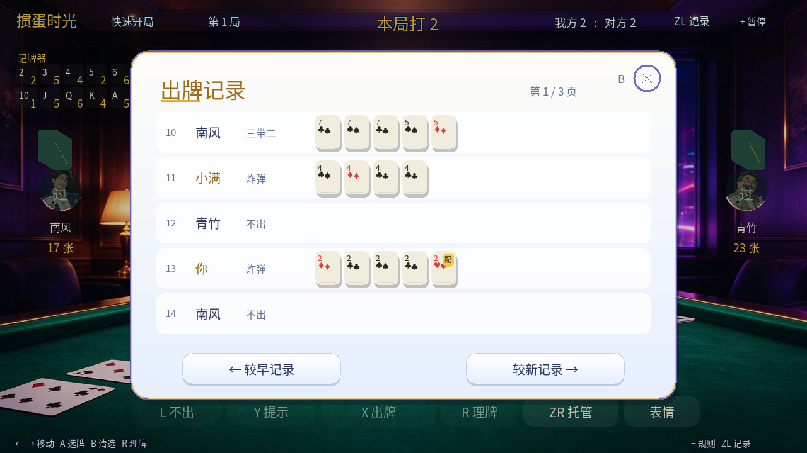
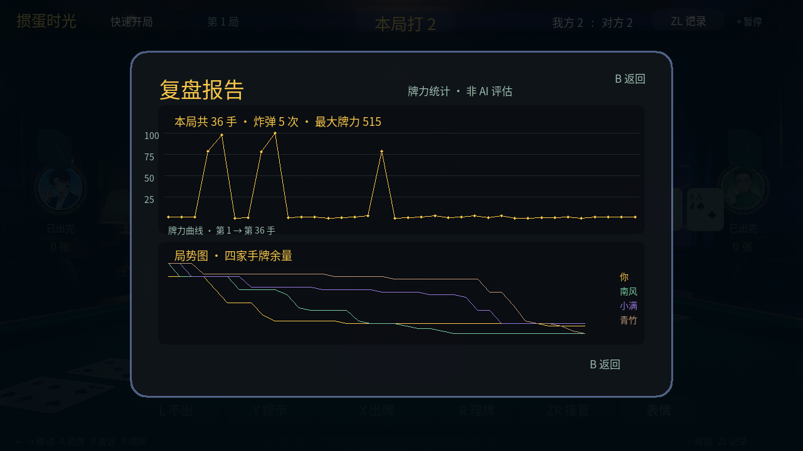
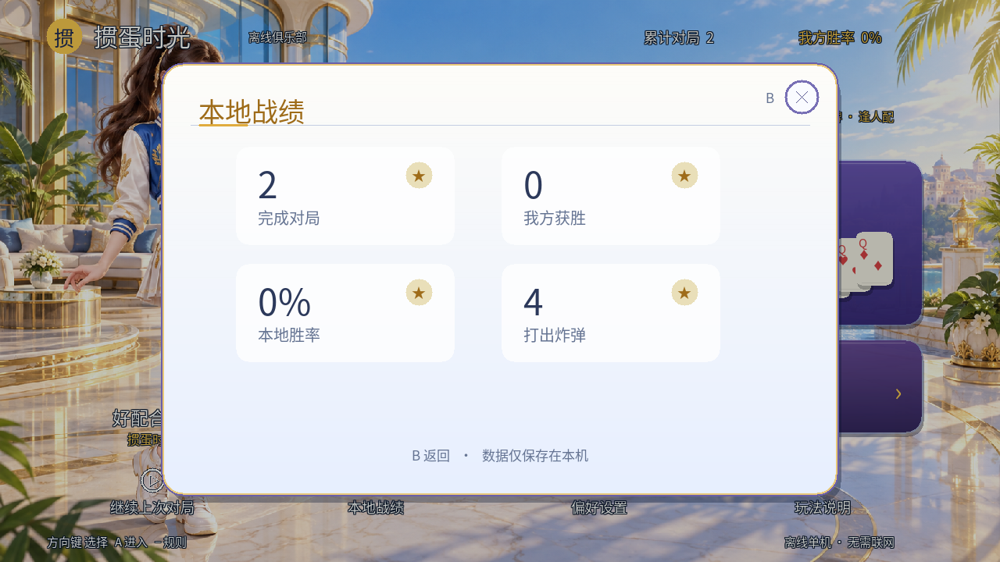

# 掼蛋时光语音版 · Switch 原生单机版

当前版本：**v0.5.2 正式版 · 掼蛋时光语音版**。用户已确认本版运行正常，现正式发布。提供独立 NSP、NRO 转发 NSP 和独立 NRO，包含 37 条离线语音、原创音乐、局内动效与三套全屏主题。

[下载独立 NSP](https://github.com/zqzhuhai-commits/guandan-switch/releases/download/v0.5.2/GuandanTime.nsp) · [下载 NRO 转发 NSP](https://github.com/zqzhuhai-commits/guandan-switch/releases/download/v0.5.2/GuandanTime-Forwarder.nsp) · [下载配套 NRO](https://github.com/zqzhuhai-commits/guandan-switch/releases/download/v0.5.2/GuandanSwitch.nro) · [完整发行包](https://github.com/zqzhuhai-commits/guandan-switch/releases/download/v0.5.2/GuandanSwitch-v0.5.2.zip) · [校验值](https://github.com/zqzhuhai-commits/guandan-switch/releases/download/v0.5.2/SHA256SUMS.txt)

| 安装包 | 运行方式 | 标题 ID |
| --- | --- | --- |
| GuandanTime.nsp | 独立运行，游戏与全部资源内嵌 | 010000ABCD000000 |
| GuandanTime-Forwarder.nsp | 先放置外置 NRO，再启动“掼蛋时光 NRO”图标 | 010000ABCD001000 |

**转发版必读：将本版 `GuandanSwitch.nro` 拷到 SD 卡 `switch/GuandanSwitch/GuandanSwitch.nro`。路径和文件名须一致。**两个 NSP 使用不同标题 ID，可以同时安装；不要拿转发版替代独立版文件。NRO 也可在 hbmenu 应用模式直接运行。

本版所有形态的音乐、音效和 37 条人声都包含在游戏资源中。密钥仅在本地打包时使用，不包含在仓库或发行包中。仓库根目录历史 `GuandanTime.nsp` 不属于本版，请使用上方 Releases 附件。界面应显示 **v0.5.2**；若没有显示，当前运行的仍是旧程序。

本项目独立编写规则、AI 和界面，不含腾讯程序、美术或音频。背景音乐为类似轻快棋牌氛围的原创编曲，游戏完全离线。

## v0.5.2 更新

- 独立 NSP 补齐 `application_type=1` 能力描述，采用应用 CPU、服务权限及 8 MiB 主线程栈；构建后检查实际 NPDM，另外检查转发器 NPDM。
- NSP 的 CNMT 内部版本从旧版一直为 0 改为 **0x00050200**，并同步 NACP 与界面版本标记。
- main 之前记录 libnx 服务初始化结果，帮助区分加载器、服务初始化和游戏内错误。
- 新增基于 nx-hbloader 的真正 NRO 转发器，固定目标路径，加入路径长度校验和启动日志。说明与 ISC 许可见 [forwarder/README.md](forwarder/README.md)。
- 提示时没有任何合法压制牌则直接“不出”；自由领出不会自动跳过。有合法牌、只是策略建议让牌时保留手动选择。
- 三类音量默认全部 **100%**，旧设置首次迁移一次，后续调整会保存。背景音乐改为 **32 秒原创 Swing 棋牌编曲**，加入手风琴、拨弦、低音与鼓点。
- 三套主题改用独立全屏新背景图，完整替换旧版程序绘制的简易场景。图源与生成说明见 [主题资源说明](docs/theme-assets.md)。

## 界面截图

以下为 v0.5.2 同源 SDL2 桌面程序实际渲染的 1280×720 截图，展示默认横排手牌、参考牌桌、菜单弹窗和细黑边扑克牌；不是实体 Switch 截图。点击图片可查看原图。

| 默认横排手牌 | 选牌与出牌按钮 |
|---|---|
|  |  |

| 恢复横排 | 记牌器 |
|---|---|
|  |  |

| 明牌详情 | 横排全手牌 |
|---|---|
|  |  |

| 明牌练习 | 开局设置 |
|---|---|
|  |  |

| 出牌记录 | 游戏设置 |
|---|---|
|  |  |

| 玩法说明 | 快捷表情 |
|---|---|
|  |  |

| 对局结算 | 复盘报告 |
|---|---|
|  |  |

| 暂停菜单 | 本地战绩 |
|---|---|
|  |  |

## 保留的界面与功能

- 三套牌桌保留原名并重绘完整场景：原色夜景为灯笼城市露台，深海蓝为海底玻璃穹顶，午夜紫为紫藤月夜露台。
- 默认横排手牌，手动理牌时散牌也各自横向排列；主界面底部四个按钮取消背景和边框。
- 加入离线中文合成人声：牌型、点数、炸弹、表情及等待台词；等待超过 11 秒每回合最多提醒一次，支持独立人声音量，播报时自动压低音乐。
- 修复动效未绘制的问题，加入发牌入场、出牌飞行、炸弹冲击、回合呼吸光圈和结算彩纸。

| 原色夜景 | 深海蓝 | 午夜紫 |
| --- | --- | --- |
|  |  |  |

- 补齐父目录创建；数据目录为 SD 根目录下 `switch/GuandanSwitch/`，与 NSP 放置位置无关。
- 修复 Switch 不能直接覆盖重命名导致的重复保存失败。牌局和设置均写入 `.tmp` 后轮换 `.bak`，失败时保留可恢复数据；旧 GD5 存档可继续读取，无需删除。
- 内嵌 32 秒原创轻快棋牌循环背景音乐，并与操作音效实时混音。在“声音与游戏设置”中分别调整背景音乐、操作音效、对局人声音量和总声音开关；v0.5.2 首次迁移开启总声音并将三类音量设为 100%，之后保留玩家偏好。
- 将音频初始化与画面启动分开，音频设备失败不再直接退出游戏。
- 将 NSP 进程描述符调整为应用类型、应用内存池、CPU 0–2 与应用优先级，并在打包后校验二进制 NPDM 字段。
- “更多 → 运行诊断 / 音频自检”可查看数据路径、最近写入错误、音频驱动、音乐载入和静音状态；支持重试。

如仍发生闪退，请保留错误代码及 `switch/GuandanSwitch/startup-v0.5.2.log`、`switch/GuandanSwitch/boot.log`；转发版另有 `switch/GuandanSwitch/forwarder-v0.5.2.log`；启动日志记录了资源挂载、字体/画面和音频初始化阶段。若文件系统本身不可写，可能无法生成日志，此时请查看模拟器运行日志。需要排查时，可结合错误代码和上述日志定位。

## 牌桌与操作

- 发牌后默认按点数排序横排；按 R 后按同花顺、炸弹、连对、顺子等分列，散牌各占一列横向排列；理牌只改变显示顺序，不改变手牌内容。牌面保留细黑边框。
- 三套全屏主题牌桌，三家头像分列、队友标记、倒计时和靠近手牌的“不出 / 提示 / 出牌 / 清空”。
- 底部“一键理牌”重新按牌型分列；“恢复”回到按点数排序横排。花色按钮只突出对应花色及逢人配，不隐藏或删除牌；“同花顺”循环选择候选组合，确认后仍须手动出牌。
- 点击列底牌型标签可选中或取消整组；支持鼠标及触屏滑动多选，同一手势不会反复切换同一张牌。
- 对手回合也可提前选牌，实际出牌仍受轮次和牌型校验。明牌模式点击对手或队友头像可放大查看该家手牌。
- 记牌器可通过顶部按钮展开；更多、规则、出牌记录、托管和表情均保持实际操作。
- 追加 12,288 组手牌排列守恒检查、24 局持续重排后的完整对局，以及分层导航、恢复和触屏命中的验证。

## v0.4 历史更新

参考用户提供的欢乐斗地主 / 大掼蛋界面，重新组织离线功能：

- 全屏海滨露台大厅（用户提供背景，所有界面取消整条页眉/页脚色块，采用悬浮文字和局部按钮）、蓝紫金玩法卡片、本地战绩信息与统一底栏；四家角色使用用户提供的透明肖像图集，运行时读取各角色，不改动原始图集。
- 大厅顶部与底部采用平滑渐变蒙版；四个导航入口增加半透明圆角底和更大文字，改善明亮背景上的对比度。
- 四种玩法进入前支持配置 AI 难度、出牌节奏和倒计时；A 默认直接开始，方向键可调整选项。
- 连按 Y 在合法出牌方案间切换，首项保留 AI 推荐（包括建议给队友让牌）；选中手牌实时显示牌型，非法出牌按钮置灰。
- ZL 打开带实际牌面的分页出牌记录，含“不出”记录；左右键或触屏按钮翻页。记录和复盘数据随牌局保存。
- GD5 新存档兼容读取 GD3 / GD4；旧存档没有历史数据，恢复后的行动开始记录。旧版程序不能读取 GD5。
- 暂停、规则、设置和记录弹窗冻结倒计时；修复桌面 Enter 在弹窗内无法确认、结算触屏无法分别返回/复盘的问题。
- 大厅、牌桌和三种主题均采用全屏场景；设置、规则、记录、战绩和复盘采用浅色中央内容卡、蓝紫边框、金色主按钮、独立关闭按钮及设置值控件，周围全屏背景保持可见。
- 调整明牌模式布局，避免记牌器遮住对手手牌；修复头像透明与颜色通道、主题切换和记牌器大小王数量。
- 复盘标记为牌力统计（非 AI 评估），修复坐标网格和玩家图例。

## 安装 v0.5.2

1. 下载 Release 中的 `GuandanSwitch.nro`，或解压完整发行包。
2. 将 NRO 放到 SD 卡 `switch/GuandanSwitch/GuandanSwitch.nro`。
3. 在支持 homebrew 的 CFW 系统中，以 hbmenu 应用模式运行（避免相册小内存模式）。字体、背景和角色已全部内嵌。

也可下载本版 `GuandanTime.nsp`，通过兼容的 homebrew 安装器安装。该形态直接包含原生程序与全部资源，无需外置 NRO。标题 ID 为 `010000ABCD000000`，与历史版本一致；更新前建议备份 `switch/GuandanSwitch/` 中的存档。

存档与设置实际保存在 SD 卡 `switch/GuandanSwitch/session.dat`、`profile.txt`。新 GD5 存档可保存出牌记录与复盘数据，兼容读取 GD3/GD4，但旧版程序不能读取 GD5。普通原厂系统无法运行本 homebrew 程序。用户已确认本版本运行正常。

## 四种模式

| 模式 | 内容 |
|---|---|
| 快速开局 | 每次进入随机发牌，完整单局，结算后可继续下一局 |
| 经典升级 | 双方从 2 打到 A，记录级别，自动完成进贡、还贡和抗贡 |
| 明牌练习 | 显示其余三家的全部手牌，便于练习配牌、拆牌与配合 |
| 定局挑战 | 固定种子的一组牌；回大厅重新进入可重试同一副首局，下一局进入后续题目 |

练习和挑战也计入本地胜率。本地数据仅作娱乐统计，不是竞技排名。

## Switch 操作

| 按键 | 功能 |
|---|---|
| 方向键 / 左摇杆 | 左右换列、上下换层；大厅和弹窗选择 |
| A | 确认 / 选中或取消当前手牌 / 发送表情 |
| X | 打出所选牌 |
| B | 清空选牌 / 关闭弹窗 / 结算返回大厅 |
| Y | 轮换提示方案，确认后按 X 出牌 |
| L | 不出；自由领出时不可不出 |
| R | 一键智能理牌并竖向分列 |
| 按下右摇杆（RS） | 恢复按点数横排 |
| 按下左摇杆（LS） | 循环突出四花色 / 全部 |
| ZR | 开启或取消托管 |
| ZL | 查看本次运行期间的出牌记录；结算后按 ZL 打开复盘报告 |
| Z | 快捷表情（8 条固定文案，方向键选择，A 发送） |
| + | 对局暂停；在大厅按 + 退出 |
| − | 玩法说明 |

支持触屏点按手牌和按钮。结算页按 A 进入下一局，按 B 返回大厅。暂停页可以保存后返回大厅。

## 功能

- 腾讯《大掼蛋》风格的牌桌界面：原色夜景、深海蓝、午夜紫三种全屏牌桌主题，圆角牌面、四角点数、逢人配金标、牌背花纹。
- **四家角色头像**（当前源码使用用户提供的透明肖像图集），出牌方带金色光环，不出/已出完状态清晰；大厅常驻吉祥物同风格。
- **结算后复盘报告**：牌力曲线（每手牌力归一展示）、四家手牌余量局势图、炸弹次数与最大牌力统计（仅描述牌力与余牌，不提供 AI 评分），每局结束按 ZL 即可回看。
- 出牌飞行动画、炸弹爆裂特效、不出气泡、快捷表情气泡、结算撒花。
- **全点数记牌器**：牌桌左上角显示 2~A、小王、大王在三家手中的剩余张数（不含自己），归零变红。
- **出牌倒计时**：轮到你时 18 秒圆环倒计时，超时自动托管出牌；可在设置中关闭。
- 三种音色操作音效、炸弹重低音、胜利琶音（波形合成，无外部音频文件）。
- 1280×720 逻辑画布，窗口/电视输出按比例缩放。
- 三档启发式 AI：休闲、标准、进阶；均只依据自身牌和公开的余牌数量决策。
- 三档 AI 出牌速度；基础操作音效可关闭。
- 逢人配标记、提示、全自动托管、手牌整理、余牌数量提示。
- 每次行动自动保存，可恢复未完成的牌局；战绩和偏好在本机保留。
- 托管中按 ZR 可重新接管。提示可能建议不出，按 L 执行。

## 本版规则口径

四人、两副完整扑克牌共 108 张，每家 27 张，对家组队。红桃级牌为配牌，可替代任意非王牌；单独打出及两张配牌作为对子打出时仍按级牌计算。

支持单张、对子、三张、三带二、固定五张顺子、固定三连对、固定二连三张（钢板）、四至十张同点炸弹、同花顺和四王炸弹。连续牌按自然点数计算，A 可作最低或最高，不能循环。

炸弹大小：四张 < 五张 < 同花顺 < 六张 < 七张 < 八张 < 九张 < 十张 < 四王。相同张数按点数比较，级牌高于 A。顺子和同花顺按最高自然点数比较。

同队获得头游、二游升 3 级；队友三游升 2 级；队友末游升 1 级。采用“打 A 且队友不是末游”过 A 的口径；必须在自己作为打 A 一方时获胜。未实现部分地方规则中的“三次不过 A 降级”或“以 A 结尾打回 2”。

升级赛自动进贡最高非配牌，自动还最低的非配牌，优先自然点数不高于 10；没有这类牌时还最低可用非配牌。单贡者持双大王或双贡方合计持双大王时抗贡。双贡中较大贡牌交给上局头游，由进较大贡牌者先出；同点时按上局名次固定决定。没有手动选还贡牌界面。

一轮中其他仍持牌者均连续不出后清桌；领出者已经出完时，由仍有手牌的队友接风。双下时不必打完其余两人的手牌，余下名次采用座次补齐，不影响双贡配对。

多种合法配牌解释由程序自动选择，优先可压住上一手的解释；自由领出时采用枚举中的合法解释。不提供手动指定配牌所代表点数的弹窗。

规则参考与差异校对：https://www.pagat.com/climbing/guan_dan.html 。本版明确采用上文的升级与还贡变体，不声称与腾讯版本或全部地区规则完全一致。

## 当前验证与限制

- 规则测试覆盖牌型、双副牌、配牌、四王与十张炸弹、非法操作、接风、存档兼容、连续进贡升级；四种模式合计 256 局自动对局。
- 同源 SDL2 桌面界面完成构建与真实操作处理函数测试，覆盖模式设置、提示轮换、暂停计时、触屏及结算导航；`preview/` 为程序实际渲染的 22 个界面，不是真机截图。
- Switch 发行文件由固定 devkitPro 工具链从当前源码编译，校验 AArch64、NRO0、内嵌资源边界及新素材内容，附 SHA-256 清单。NSP 只在构建输入齐全时生成并校验；历史 NSP 不冒充本版。
- 用户已确认 v0.5.2 运行正常，并将其作为“掼蛋时光语音版”正式发布；这一反馈不代表所有设备和系统组合均已测试。
- 进阶 AI 是规则启发式策略；复盘展示牌力和余牌统计，不声称竞技 AI 评估。已提供离线语音播报；没有联网对战、本地多人或残局编辑器。
- 出牌记录与复盘数据随当前牌局保存，下一局开始后重新记录；本地战绩和偏好单独保存。

## 源码与构建

仓库根目录包含规则引擎、SDL2 界面、测试、字体和 Makefile。发行 ZIP 中源码位于 `source-project`。

为兼容上传接口，完整发行包保存在 `release/*.partNN`，各片的校验值在 `release/manifest.json`。克隆后先执行 `python3 tools/restore_assets.py`，自动校验并还原完整 ZIP、内置字体和单文件 NSP；不需要联网下载字体。

Switch 构建依赖 devkitPro 的 devkitA64、libnx、switch-sdl2、switch-sdl2_ttf、FreeType、HarfBuzz、zlib、libpng、bzip2。设置 `DEVKITPRO`、`DEVKITA64`，把 `portlibs/switch/bin` 和 `tools/bin` 加入 PATH 后，在工程目录执行 `make APP_JSON= APP_VERSION=0.5.2 -j2` 生成独立 NRO。

本次使用的开发环境镜像为：
`devkitpro/devkita64@sha256:82575ea78651b530b2e232bb3799cfd1fe331514e053d5f724bb4b28191fb79d`

桌面构建可用系统 SDL2/SDL2_ttf 开发包执行 `make -f Makefile.desktop`。测试：`make -f Makefile.desktop test test-ui`。后者直接运行程序的手柄 / 触屏处理函数，覆盖模式配置、提示轮换、暂停计时、记录翻页、结算导航。

桌面实际界面截图：安装 Pillow 后执行 `python3 tools/capture_previews.py`；脚本使用独立临时存档和固定发牌种子，不覆盖玩家存档。可通过 `--data-dir <目录>` 指定桌面存档目录。GitHub Actions 的 `Verify game and desktop UI` 会自动构建、测试并上传界面截图。

原生 NSP 的构建由 `tools/packaging/build_nsp.mjs` 完成：使用本次编译的 NSO、NPDM、NACP 和当前 RomFS，核对 NCA 内容散列及内嵌资源；需要调用者提供 `NSP_KEYS`，详见下面的可复现发布说明。

原创代码按 MIT License 提供；第三方库与字体遵循各自许可，见 `licenses` 与字体目录的许可文件。App 图标采用用户提供的“掼蛋时光”鎏金宣传视觉（蓝色背景、金色立体字、蓝宝石金冠与三张扑克牌），缩放为 256×256 后内嵌于 NSP，不与腾讯任何资产共用。

## 可复现发布

`.github/workflows/publish.yml` 先运行规则及桌面交互检查，再使用固定摘要的 devkitPro 镜像交叉编译当前源码；校验 NRO0、内嵌资源和文件边界，生成完整 ZIP 与 SHA-256 校验清单。主分支检查成功后保留原生构建产物；`.github/workflows/publish-nsp.yml` 使用 `release/v0.5.2/native-nsp.json` 固定的构建记录、NSP 分片及 SHA-256 创建发行附件；`.github/workflows/promote-voice-release.yml` 将用户确认的 v0.5.2 晋升为正式版并设为 Latest，保留原有安装包及校验值。

如需自行构建原生 NSP，可在本地将自己的 prod.keys 内容读入 `NSP_KEYS` 环境变量，运行 `node tools/packaging/build_nsp.mjs`。构建器使用标准 AES-CTR 加密 NCA 主体并核对解密后的原生程序、NPDM、图标、版本和全部素材；输入仅在内存中使用。GitHub 发布流程不接收密钥，只还原并核对已打包文件的分片和散列。

本版 NSP 的本地打包使用调用者提供的 `prod.keys`。这是独立 homebrew，不使用商业游戏的 title keys。`release/v0.5.2/` 仅保存已打包的 NSP 分片和校验信息，不含密钥；可运行 `python3 tools/restore_native_nsp.py` 还原到 `dist/GuandanTime.nsp`。发行包中的 `BUILD-SOURCE-COMMIT.txt` 标识原生编译的源码提交，`SOURCE-COMMIT.txt` 标识包含文档和截图的打包提交。

默认发牌按点数排序横排。点击“恢复”回到横排，按 R 可手动智能理牌，散牌不会叠成竖列；桌面可用 C 恢复、F 切换花色、G 查找同花顺、K 展开记牌器。

音乐音轨位于 `romfs/music.wav`，可用 `python3 tools/audio/generate_music.py` 重建；源码与音乐许可见 `licenses/music.txt`。保存协议和异常回滚由 `tests/storage.cpp` 验证；真实混音器的非静音、独立音量、静音和设备失败行为由 `tests/audio.cpp` 验证；`tools/verify_runtime.py` 对实际可执行文件进行路径和音频故障注入。

离线人声位于 `romfs/voice.wav` 与 `voice.idx`，共 37 条，用于点数、牌型、等待、胜负和表情播报。由 MIT 许可的 [MeloTTS 中文模型](https://huggingface.co/csukuangfj/vits-melo-tts-zh_en) 生成，许可见 `licenses/MeloTTS.txt`；不是参考 APP 原声或特定人物配音。重建脚本 `tools/audio/generate_voice.py` 仅在开发电脑运行，游戏不包含 TTS 模型或推理引擎。
